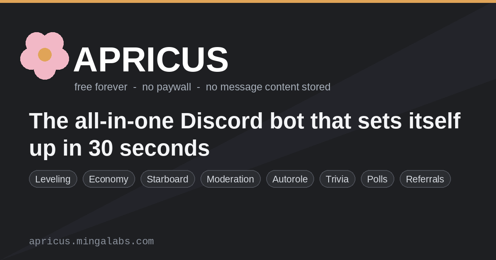

# Apricus — all-in-one Discord bot

Apricus is a zero-config, all-in-one Discord bot: moderation, leveling, economy,
starboard, trivia, scheduled events, one-tap setup and utilities — live from a
single install. 80+ slash commands, no dashboard, no config files.

**➕ [Add Apricus to your server](https://discord.com/api/oauth2/authorize?client_id=1565375148717121616&permissions=564496410471639&scope=bot%20applications.commands)** — one click, pick your server, done.

**Live showcase:** https://apricus.mingalabs.com/

**Community server:** https://discord.gg/FZzsqF5DC5

## What it does

| Domain | Highlights |
| --- | --- |
| Moderation | warnings, mutes, timeouts, case log, audit-friendly mod commands |
| Leveling | XP, ranks, role rewards, `/rank` leaderboard |
| Economy | currency, shop, `/daily` rewards |
| Starboard | star-pinned highlights per server |
| Trivia & events | `/dailytrivia`, scheduled events, polls |
| Quick setup | `/setup` and `/tour` one-tap configuration for a new server |
| Utilities | reminders, feedback, changelog, autorole, referrals, server analytics |
| Referrals | `/installref` mints your own install link — 250 Apricots when someone adds Apricus to a new server from it. They can run `/installclaim <code>` there to credit you instead of the default attribution |

## MEE6 alternative (and why not Carl-bot either)

One install instead of three bots: moderation, leveling, economy, starboard and
trivia together, configured in about 30 seconds with `/quicksetup` - no dashboard,
no config file, no premium paywall for the basics.
Side-by-side comparison: https://apricus.mingalabs.com/mee6-alternative.html

## Quick start

1. **[Add Apricus](https://discord.com/api/oauth2/authorize?client_id=1565375148717121616&permissions=564496410471639&scope=bot%20applications.commands)** and pick your server.
2. Run `/quicksetup` — it creates its own channels and flips itself on. About 30 seconds.
3. Run `/tour` to see what is available, or `/daily` to try something immediately.

No dashboard. No config file. Nothing to paste into a web form.

## FAQ

**Is it free?** Yes. Every feature listed above is available without a premium tier.
**Is it open source?** No. Apricus is a closed-source hosted service; this repo holds only the landing pages.
**What data do you collect?** Per-server settings and the minimum needed to run the features you use. The public site uses one privacy-minimal page counter (Abacus) — no cross-site tracking, fingerprinting or profiling.
**Do I need administrator to set it up?** The one-tap and `/quicksetup` flows need "Manage Server", the same bar every setup command advertises.

## Pages in this repository

- [`index.html`](https://apricus.mingalabs.com/index.html) — main showcase
- [`mee6-alternative.html`](https://apricus.mingalabs.com/mee6-alternative.html) — MEE6 alternative comparison
- [`discord-moderation-bot.html`](https://apricus.mingalabs.com/discord-moderation-bot.html) — moderation bot feature breakdown
- [`index_new_design.html`](https://apricus.mingalabs.com/index_new_design.html) — alternate layout
- [`discord-permissions-calculator.html`](https://apricus.mingalabs.com/discord-permissions-calculator.html) — interactive permissions calculator

## Why this repo

This repository serves the public landing pages for the bot via GitHub Pages.
If you are evaluating Apricus, start at the showcase above, or install the bot and
run `/tour`.

Apricus is a hosted service. This repository contains only the public landing pages listed above -- not the bot's source code. Apricus is not open-source, and there is no source repository to read or fork.

Everything is configured per-server with slash commands.
